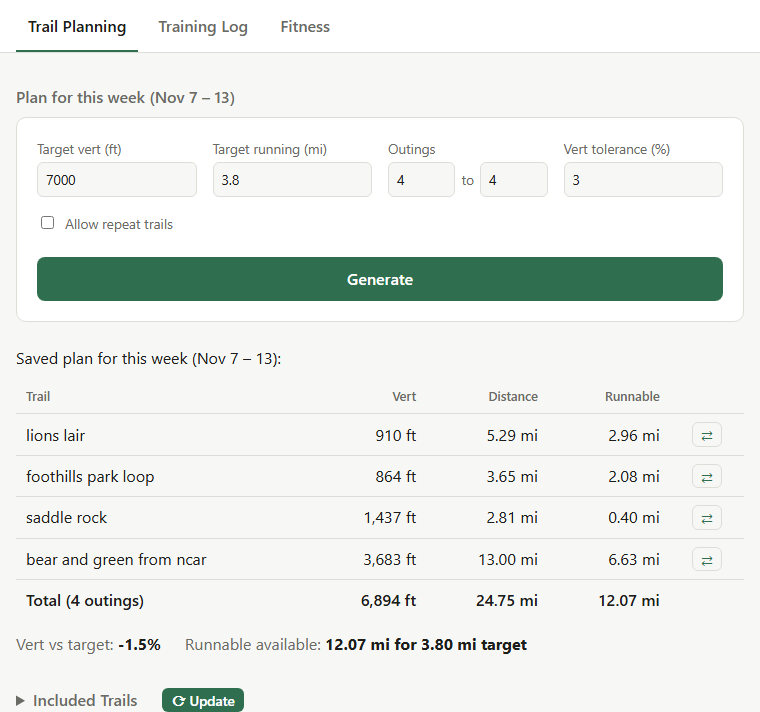
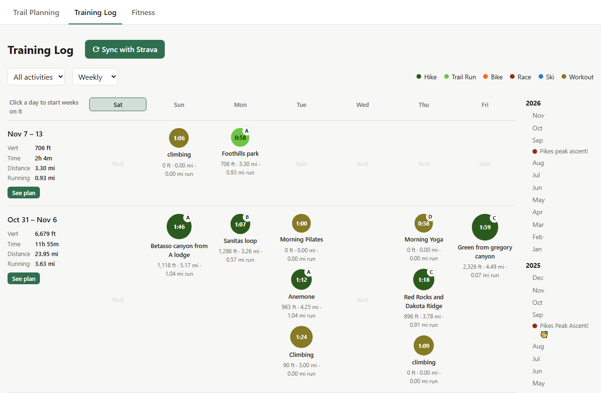
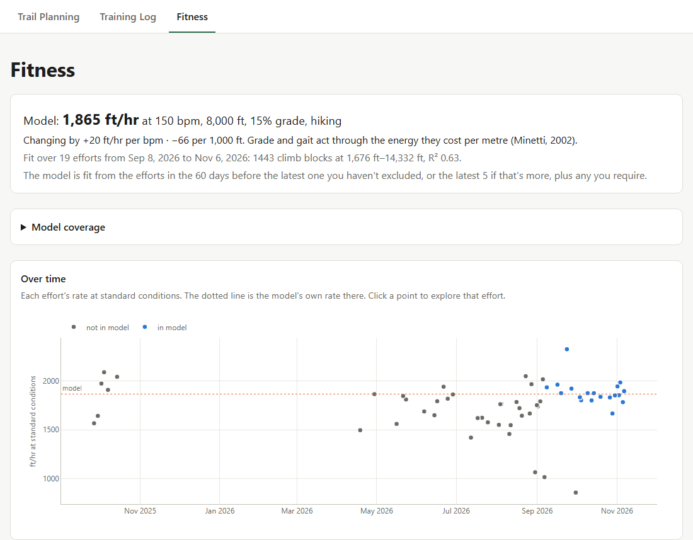

# Trail Trainer

*README text and code implementation by Claude Opus 5.5*

A local web app for training for trail running and hiking. It runs on your own computer, reads your own trails and your own Strava history, and has three tabs:

- **Trail Planning.** You give it the vert and running miles you want this week. It picks a set of trails from your list that hits the vert within a small tolerance and has enough runnable terrain for the running target.
- **Training Log.** Your Strava activities on a calendar, by week, month or year, with each period's vert, time, distance and running miles.
- **Fitness.** A model of how fast you climb for a given heart rate and elevation, fit to your recent efforts, and how each effort compares with it.







## Getting started

### 1. Install

You need [uv](https://docs.astral.sh/uv/). It installs Python 3.13 and the project's dependencies for you:

```
git clone <this repo>
cd trail_trainer
uv sync
```

### 2. Start the app

```
uv run python -m trail_trainer.app
```

Then open http://localhost:5000 in your browser. The app reads its data files on every request, so you can leave it running while you add trails or import activities.

At this point the Trail Planning tab works with the trails that come with the repo, and the Training Log and Fitness tabs are empty. The next two steps put your own data in.

### 3. Add your trails

The repo comes with the author's trails around Boulder, Colorado, as an example. To start your own list instead, delete the files in `gpx/` and replace the contents of `available_trails.json` with `{}`. (Don't delete the JSON file itself; the app expects it to exist.)

To add a trail:

1. Download the route as a GPX file, from Strava, AllTrails, CalTopo, your watch, etc.
2. Put it in `gpx/`, named after the trail, e.g. `Green_from_NCAR.gpx`.
3. On the Trail Planning tab of the web page, near "Included Trails", click "Update"

This computes each trail's distance, vert and runnable miles and writes them into `available_trails.json`. If you expand Included Trails, you'll see the new trails as new rows in the table. Run it again whenever you add or change a GPX file; a file that matches an existing trail (ignoring case) updates it.

**Correcting a trail by hand.** Each trail in `available_trails.json` has a `from_gpx` block, which the script rewrites, and a `manual` block, which it never touches. A value in `manual` takes priority:

```json
"green_from_ncar": {
    "from_gpx": {"distance_mi": 11.42, "vert_ft": 2468, "runnable_mi": 5.65},
    "manual": {"runnable_mi": 4.0}
}
```

Use it to lower `runnable_mi` on a trail whose gentle grades are too rocky to run, or to add a trail you have no GPX file for by giving all three of `distance_mi`, `vert_ft` and `runnable_mi`.

### 4. Bring in your activities

The Training Log and Fitness tabs need your recorded activities. There are two ways to get them from Strava. Most people will do both: the account export once for their whole history, then syncing to keep up to date.

#### a. Strava account export (free)

Strava lets anyone download their whole history as a zip file:

1. On strava.com, go to **Settings → My Account → Download or delete your account**, and request an archive. Strava emails you a link to the zip; it can take a few hours.
2. Put the zip somewhere in the project, e.g. `recorded_activities/` (git ignores that folder), and run:

   ```
   uv run python -m trail_trainer.import_strava_export recorded_activities/export_<id>.zip
   ```

This copies each activity's recording into `activity_files/` and adds it to `training_log.json`. After that the zip isn't needed. Importing a newer export later updates every activity and keeps any edits you've made on the site.

Two things the export doesn't include, which syncing fills in: whether a run was marked as a race, and the local start time (for GPX recordings, this computer's time zone is used instead).

#### b. Sync with Strava (needs a Strava subscription)

The **Sync with Strava** button on the Training Log fetches new activities directly from Strava. It uses Strava's API, and since June 2026 Strava only allows API access to people with a paid Strava subscription, even for personal tools like this one. You also have to register your own API application with Strava; this app doesn't come with one.

Set it up once:

1. With your Strava account (with a subscription), create an API application at https://www.strava.com/settings/api. The name, website and icon can be anything. Set **Authorization Callback Domain** to `localhost`.
2. Create `strava_app.json` in the project folder with the application's Client ID and Client Secret from that page:

   ```json
   {"client_id": "12345", "client_secret": "..."}
   ```

3. On the Training Log tab, click **Sync with Strava**. The first time, it sends you to Strava to approve access to all your activities, including private ones, and then back to the app, where the sync runs. The access Strava grants is saved in `strava_tokens.json` and renewed automatically, so later syncs don't ask again.

Keep `strava_app.json` and `strava_tokens.json` private. Git already ignores them.

Strava allows 100 requests every 15 minutes, and each new activity takes two. Syncing a long history from scratch will hit that limit: the sync keeps what it got and tells you how many are left, and you sync again in 15 minutes. Importing the account export first avoids this, since the sync then only fetches what's newer.

#### Without a Strava subscription

Without a subscription, the account export is the only way in. To bring in new activities, request a fresh export and import it again; the import updates what's already there and adds what's new, and your edits are kept.

Strava also offers a download of a single activity (**⋯ → Export Original** on the activity's page), but the app can't import those individual files yet; it only reads the whole-account zip.

#### Without Strava at all

The app only reads activities from Strava for now, so without a Strava account the Training Log and Fitness tabs stay empty. Trail Planning works without any activities.

## Using the app

Each tab is meant to be explorable from the page itself. For details on what the numbers mean and how they're worked out, see:

- [Trail Planning](docs/trail_planning.md): how trail stats are computed and how plans are picked.
- [Training Log](docs/training_log.md): the calendar views, editing activities, and how distance, vert, moving time and running miles are computed.
- [Fitness](docs/fitness.md): which efforts count, the scores, and the Explore page. The model itself is described in [the fitness model](docs/fitness_model.md).

## Your data

Everything stays on your computer, in these files in the project folder. Git ignores all of them except the trail list:

| File | What it holds |
|---|---|
| `gpx/`, `available_trails.json` | Your trails |
| `training_log.json` | Every activity: Strava's summary, the app's numbers, and your edits |
| `activity_files/` | Each activity's recording |
| `week_plans.json` | The plans you've saved for each week |
| `climb_blocks.json` | A cache for the Fitness tab; safe to delete |
| `strava_app.json`, `strava_tokens.json` | Your Strava API application and its access (keep private) |

## Not yet supported

- Importing single activity files, or activities from anywhere but Strava.
- Planning by time instead of vert. Time depends on how much of each trail you run, so it would need a pace model.
- Automatic link-ups. A combined route like `bear_and_green_from_ncar` needs its own entry and GPX file.
- Removing activities deleted on Strava. A sync lists them under the calendar, and you can delete their entries from `training_log.json` by hand.
- A model of running on flat ground or downhill; the Fitness tab models climbing only.

## Development

See [CLAUDE.md](CLAUDE.md) for the code layout, data formats and how to run the tests.
