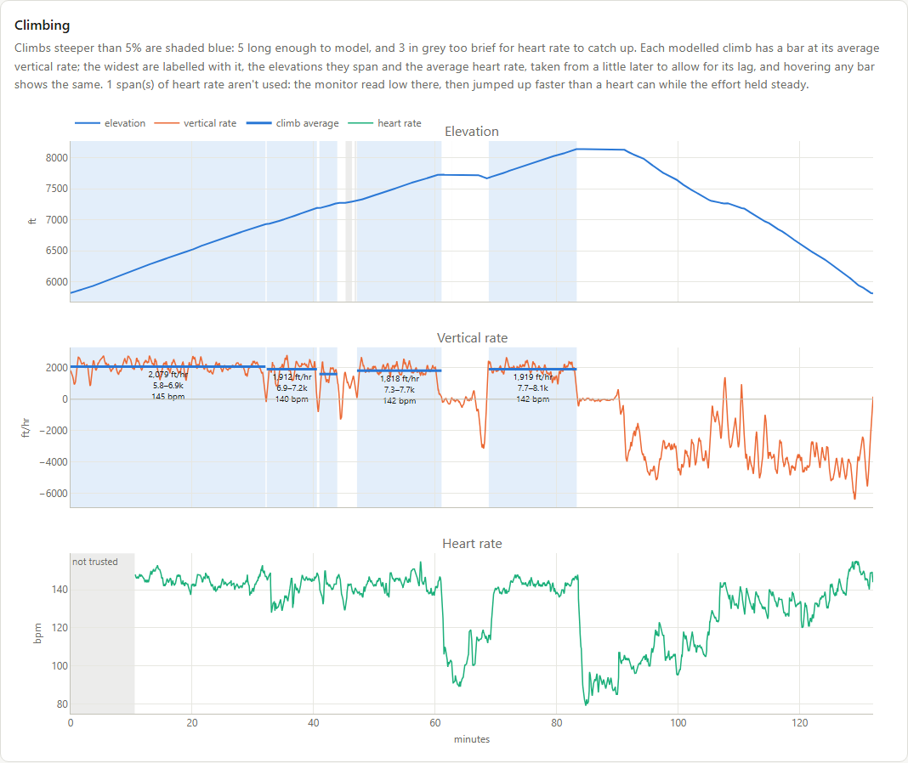
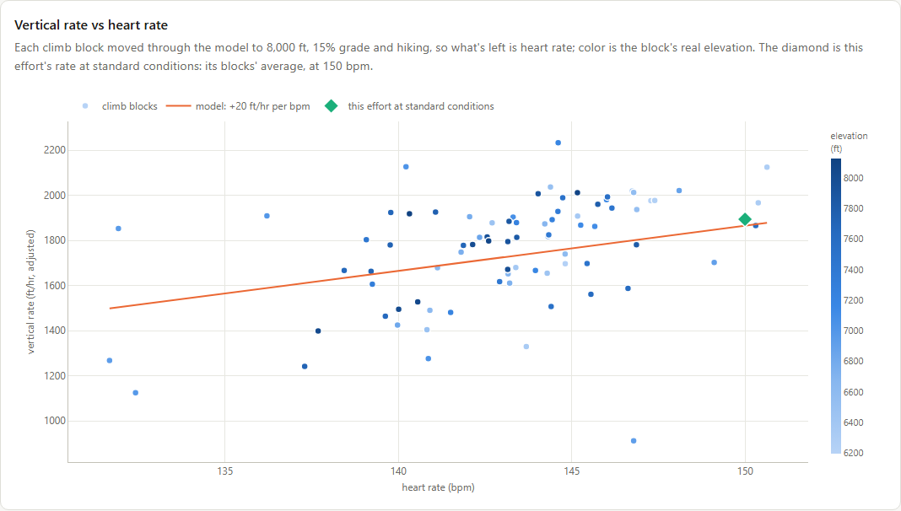
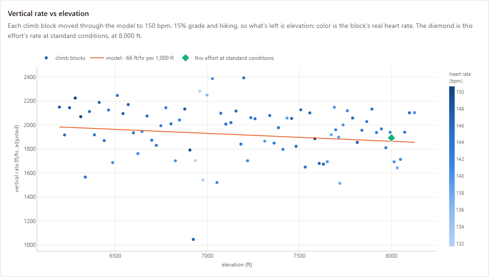

# Fitness

The Fitness tab tracks how fast you climb. It fits a model of climbing rate against heart rate and elevation to your recent efforts, then scores every effort against it. How the model works is described in [the fitness model](fitness_model.md).

Only activities whose recordings have heart rate can be efforts, so you need a heart rate monitor (or a watch that records heart rate) for this tab to show anything.

## Efforts

An **effort** is a hike, trail run or race whose recording has heart rate and at least 10 minutes of sustained climbing at 120 bpm or more. See [the fitness model](fitness_model.md#what-counts-as-climbing) for exactly what counts as climbing.

**Which efforts the model uses.** By default, the efforts from the 60 days before the latest one; if that's fewer than 5, the latest 5. In the efforts table, **Require** puts an effort in the model whatever its date, and **Exclude** keeps one out, e.g. a hike carrying a heavy pack. The model only knows about elevations it was fit on, so when comparing efforts at different elevations, require some efforts that span them.

## Scores

Each effort gets two numbers:

- **At standard**: the effort's climbing rate moved through the model to 150 bpm, 8,000 ft and 15% grade, hiking. It answers "how fast was I climbing?" in ft/hr, whatever the terrain, heart rate and gait. The chart above the table plots it over time.
- **Vs model**: how much more vert the effort climbed than the model predicted for its own heart rate, elevation, grade and gait. An effort that's in the model is compared with the model fit without it, so it isn't partly compared with itself. ⚠ marks an effort with climbing at elevations that model wasn't fit on, where the comparison extrapolates.

## Model details

**Model details**, collapsed until you open it, shows the climbing the model is fit on. It redraws as you require or exclude efforts.

- **Coverage** is a heatmap of the minutes of climbing by heart rate and elevation. Blank cells are where the model extrapolates. Hover over a cell to see which efforts are in it.
- **Vertical rate vs heart rate** and **vs elevation** plot every 45 s block of climbing, adjusted through the model to standard conditions in everything but the variable on the x-axis, with the model's line. Hover over a block to see which effort it's from.

## Explore

**Explore** opens an activity's own page. Every activity with a recording that covers distance has one, effort or not. It shows the activity's elevation and grade, and its climbs with each one's average rate and heart rate.

An effort's page also shows its scores, its climbing rate block by block against what the model predicted, and, under **Model details**, the same three plots with the effort's own blocks picked out.

The first visit to the tab works out every activity's climbs, which takes about half a minute. After that they're cached in `climb_blocks.json`.
